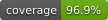
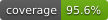

# NW.UnivariateForecasting

| NW.UnivariateForecasting | NW.UnivariateForecasting.CLI |
|---|---|
|||

Contact: numbworks@gmail.com

## Introduction

From the documentation:

> `NW.UnivariateForecasting` is a library to perform univariate forecasting tasks on the values you provide. 

> `NW.UnivariateForecasting.CLI` is a command-line application built on the top of `NW.UnivariateForecasting`.

## Getting started

- [Documentation (NW.UnivariateForecasting)](docs/docs-nw.univariateforecasting.md)
- [Documentation (NW.UnivariateForecasting.CLI)](docs/docs-nw.univariateforecasting.cli.md)

## Other Links

- [LICENSE](LICENSE)